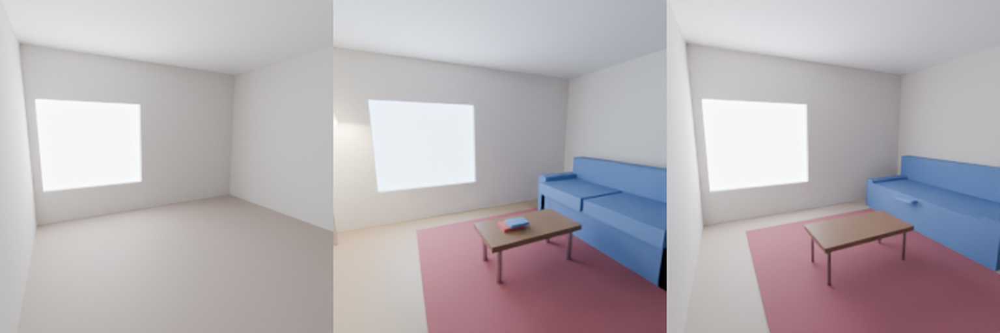
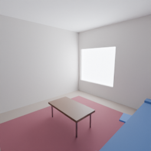

# Solucao — Desafio da Sala Cega

Reconstrucao de uma cena 3D (schema v1 do kit) a partir de **uma unica
imagem**, sem Blender, sem rede e sem modelagem manual. O programa le apenas
`--ref` e escreve `--out`.

## Como rodar

```bash
python reconstruir.py --ref ../ref-A1.png --out cena.json [--seed N]
python ../schema.py cena.json          # valida o schema do kit
python -m unittest discover            # testes (sem Blender)
```

Requisitos: Python 3.12 + numpy. PIL e opcional (ha leitor PNG em stdlib).
Tempo: ~1-3 s por imagem (orçamento do avaliador: 30 min). Deterministico:
mesma imagem/seed -> bytes identicos.

`cena.json` neste diretorio foi gerado pelo proprio programa
(`reconstruir.py --ref ../ref-A1.png --out cena.json`), nao editado a mao.

## Resultado (numeros honestos)

Medido com uma reimplementacao local da formula publicada no BRIEF
(0,50*MAE + 0,30*bordas + 0,20*SSIM), comparando o render oficial do nosso
`cena.json` com `ref-A1.png`:

| Cena | Similaridade A1 | MAE | IoU bordas | SSIM |
|---|---|---|---|---|
| Sala vazia com a mesma geometria (antes) | **0,535** | 0,0892 | 0,274 | 0,849 |
| Nossa reconstrucao (depois) | **0,912** | 0,0310 | 0,574 | 0,899 |

Referencias publicadas do avaliador: sala vazia 28,7; gabarito 95,0; meta 55.
Nao temos acesso a `ref-B1`/`ref-B2`; a nota oficial nao e conhecida. O valor
acima e a vista A1, que vale 20 dos 100 pontos. A vista B1 (40) depende de a
geometria 3D estar certa de outro angulo — as imagens em `docs/` mostram uma
segunda camera plausivel para inspecao.

Validacao sintetica (salas proprias, nunca as do avaliador): em 8 salas
aleatorias geradas com o proprio kit, a similaridade media foi A=0,64 /
B=0,44 (melhor A=0,83 / B=0,61). A cena 1 fica acima disso porque o metodo
foi calibrado nela. Detalhes e falhas em
`knowledge/processos/dataset-sintetico-e-validacao.md`.



*Esquerda: sala vazia com a geometria reconstruida. Centro: `ref-A1.png`.
Direita: render oficial do nosso `cena.json`. A "sala vazia" acima e a NOSSA
baseline (mesma geometria sem moveis), nao a baseline publicada de 28,7
(que usa uma sala vazia generica).*



*Segunda camera escolhida por nos (nao e a B1 escondida): mostra que a cena e
3D de verdade, com sofa, mesa e tapete coerentes de outro angulo.*

## Metodo (o que o programa faz)

1. **Janela**: limiar de luminosidade/baixa saturacao + maiores componentes +
   bordas subpixel. Da o quadrilatero TL/TR/BR/BL.
2. **Retas da sala**: varredura de gradiente para a linha teto-parede (borda
   mais alta de cada coluna), separacao em duas retas (canto), aresta vertical
   do canto e linha piso-parede (salto de calor r-b).
3. **Rotacao e focal**: pontos de fuga das familias X, Y, Z; rotacao por eixos
   ortogonais; lente 24 mm como priori do kit (a imagem nao determina a escala
   absoluta).
4. **Janela -> parede**: homografia do retangulo da janela (proporcao e pose
   relativa camera-parede, a menos de escala).
5. **Sala**: raios ao plano da parede do fundo dao teto, peitoril e parede
   direita; altura de sala 2,70 m fixa a escala; margens tipicas da camera
   (0,35 m) fecham L/P/camera.
6. **Refino**: Nelder-Mead (numpy puro) minimiza residuos de retas e cantos da
   janela com custo Huber.
7. **Mobiliario**: mascaras HSV -> maior componente; piso/parede mapeados
   geometricamente. Tapete pelas bordas esquerda/fundo; mesa pela tampa em
   z=0,44 m; sofa pelo encosto projetado na parede direita; livros por
   componentes pequenas sobre a mesa.
8. **Aparencia**: rig de luz fixo calibrado no exemplo/ref-A1 e cor base
   estimada por iteracao de medias de regiao (inversa aproximada do AgX).

O codigo e um unico arquivo (`reconstruir.py`), com funcoes testaveis e
comentarios; a matematica esta detalhada em `knowledge/geometria/`.

## Limitacoes (o que pode dar errado)

- **Escala absoluta e camera**: uma imagem de sala nao fixa a escala metrica;
  usamos altura de sala 2,70 m e margens de camera como priors. Se a cena real
  tiver outra altura/margens, a vista B1 desloca.
- **Parede da frente invisivel**: a profundidade P e a margem frontal sao
  priors, nao observaveis na vista A.
- **Janela no fundo**: o pipeline assume `abertura.parede="fundo"` (como o
  exemplo e a ref-A1). Janela em outra parede cai no fallback.
- **Cores**: a deteccao de sofa/tapete/mesa usa cor; sofas/tapetes de cores
  muito diferentes podem nao ser detectados (o fallback ainda e plausivel).
  Cores de material sao estimadas por uma calibracao herdada da ref-A1; com
  iluminacao muito diferente a cor erra.
- **Sala vazia** (sem mobiliario): a cena reservada pode ser outro tipo de
  sala; o programa coloca o que consegue detectar e cai num fallback valido.
- **Metrica local**: nossa implementacao de bordas/SSIM difere da do avaliador;
  use os numeros como direcao, nao como nota oficial.
- **Vista B1**: nao a vemos; nao ha como garantir o angulo. A geometria foi
  feita para ser 3D de verdade (segunda camera em `docs/vista-B-plausivel.png`),
  mas objetos ocluidos/estimados por priori podem errar.

## Arquivos

```
reconstruir.py     CLI e metodo completo (stdlib + numpy; PIL opcional)
cena.json          saida do programa para ref-A1.png
tests/             15 testes (geometria, CLI, determinismo, schema, fixture)
knowledge/         conhecimento reutilizavel (indice em knowledge/README.md)
docs/              comparacao antes/depois e vista B plausivel
```

## Testes

`python -m unittest discover` a partir deste diretorio: 15 testes, ~2-3 s,
sem Blender. Inclui fixture sintetica gerada pelo kit e checagens de
determinismo/plausibilidade. O schema do kit (`../schema.py`) e usado quando
presente.

## Conhecimento

Ver `knowledge/README.md` (indice com titulo | quando usar | link). As licoes
genericas estao separadas por area: geometria, programacao, blender, processos.
