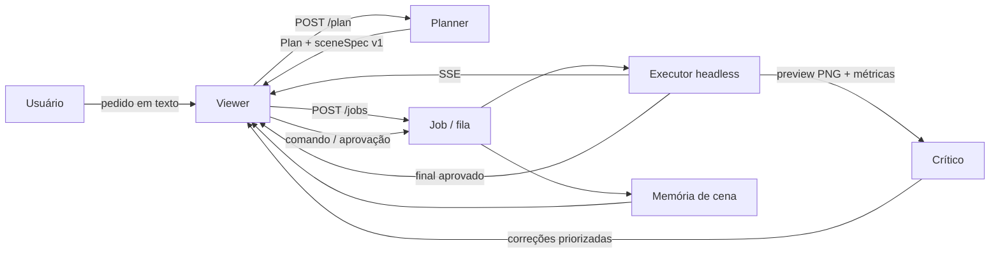

# Spec de arquitetura — Blender Director v2

**Status:** proposta da fase 1. A camada de intenção (`planner.js`, `POST /plan`), o esqueleto do crítico (`critic.js`) e o painel "pedido → plano" do viewer **já existem** neste repositório. O restante (integração com modelo, crítico de imagem real, memória de cena e UI final) está especificado aqui e fica para a fase 2.
**Base de pesquisa:** [`pesquisa-agentes-blender.md`](./pesquisa-agentes-blender.md) — como Claude/ChatGPT conduzem o Blender, loop real, custos, limites e riscos.
**Contrato v1 vigente:** [`schema.md`](../tools/blender-director/schema.md).

---

## 1. Objetivo

Reproduzir a experiência de "pedido em linguagem natural → o agente conduz o Blender em passos → olha o preview → corrige → repete → humano aprova", **sem** abrir mão do que a v1 já garante:

- scene-spec JSON fechado, validado e reproduzível;
- execução headless isolada por job;
- preview barato por SSE;
- gate de aprovação humana antes do render final;
- nenhum Python arbitrário vindo do modelo.

A v2 acrescenta **intenção**, **memória de cena** e **crítica visual** ao redor do executor existente. Ela não reescreve o executor nem o schema v1.

### 1.1 Fora do objetivo desta fase

Ver seção [10](#10-fora-de-escopo). Em resumo: não há chamada de modelo paga, não há cálculo de métrica de imagem, não há UI final e não há mudança no contrato v1.

---

## 2. Princípios

1. **Aditivo, não reescrita.** `POST /jobs`, o schema v1, os comandos e o SSE existentes continuam válidos. A v2 é um envelope opcional e novos endpoints.
2. **O modelo propõe; a aplicação executa.** O planner devolve um plano/scene-spec; o executor só aplica o vocabulário validado ([pesquisa §2.1](./pesquisa-agentes-blender.md#2-como-o-claude-chega-ao-blender)).
3. **Determinístico quando possível.** Regras primeiro; modelo é um gancho opcional. O mesmo pedido + as mesmas opções = o mesmo plano.
4. **Barato antes de caro.** Preview 640/32 → crítica → correção → só então final.
5. **Humano no loop.** Aprovação explícita para render final e para qualquer ação destrutiva.
6. **Falha explícita.** Erro vira estado `error` com log e correção sugerida; nunca "segue como se tivesse dado certo".
7. **Sem promessa de realismo absoluto.** Métricas e checklist medem o que dá para medir; o resto é decisão humana.

---

## 3. Arquitetura

### 3.1 Diagrama em texto

```text
┌──────────────────────────────────────────────────────────────────────────────┐
│                              VIEWER (127.0.0.1)                              │
│  pedido ──► plano/etapas ──► preview ──► crítica ──► correções ──► aprovação  │
│     ▲            │              ▲            │            │             │      │
│     └────────────┴──────────────┴────────────┴────────────┴─────────────┘      │
│                         SSE (/events) + HTTP (/plan, /jobs)                   │
└───────────────────────────────────┬──────────────────────────────────────────┘
                                    │
┌───────────────────────────────────▼──────────────────────────────────────────┐
│                              SERVER (Node 22, stdlib)                        │
│                                                                              │
│  ┌─────────────┐   ┌──────────────┐   ┌──────────────┐   ┌────────────────┐  │
│  │  INTENÇÃO   │──►│   EXECUTOR   │──►│   CRÍTICO    │──►│    MEMÓRIA     │  │
│  │ planner.js  │   │  fila +      │   │  metrics +   │   │  ledger de     │  │
│  │ regras +    │   │  renderer +  │   │  critic.js   │   │  revisões      │  │
│  │ gancho      │   │  preview     │   │  correções   │   │  (spec + why)  │  │
│  │ modelo      │   │  SSE         │   │  priorizadas │   │                │  │
│  └─────────────┘   └──────┬───────┘   └──────────────┘   └────────────────┘  │
│         │                 │                                                   │
│         │ scene-spec v1   │ spawn / JSONL                                     │
│         ▼                 ▼                                                   │
│  ┌─────────────────────────────────────────────────────────────────────────┐  │
│  │  Blender headless (build.py)  ou  fake-blender.js (fixture)             │  │
│  │  preview-001.png  |  final-001.png  |  manifest.json                   │  │
│  └─────────────────────────────────────────────────────────────────────────┘  │
└──────────────────────────────────────────────────────────────────────────────┘
```

### 3.2 Mermaid



### 3.3 Componentes e responsabilidades

| Componente | Responsabilidade | Estado | Fase 1 |
| --- | --- | --- | --- |
| `planner.js` | Pedido → plano de etapas + scene-spec v1; desambiguação; gancho de modelo | Puro, determinístico | **Implementado** |
| `POST /plan` | Expõe o planner | Sem estado | **Implementado** |
| `critic.js` | Métricas + checklist → correções priorizadas | Puro | **Implementado (esqueleto)** |
| `metrics.js` (proposto) | Calcular SSIM/ΔE00/PSNR e alinhar imagens | Puro | Fase 2 |
| `server.js` | HTTP, SSE, fila, jobs, gate de aprovação | Em memória + `runs/` | v1 existente |
| `memory` (proposto) | Ledger append-only de revisões da cena | `runs/<job>/memory.json` | Fase 2 |
| `viewer/` | Mostrar pedido → plano → preview → crítica → aprovação | Cliente | **Plano implementado**; crítica/UI final na fase 2 |
| `build.py` / `fake-blender.js` | Construir e renderizar | Processo por job | v1 existente |

---

## 4. Camada de intenção

### 4.1 Pipeline

```text
texto livre
   │ normalização (acentos, caixa)
   ▼
detecção de sinais (sujeito, material, cor, clima, enquadramento, fundo, resolução)
   │
   ▼
regras de desambiguação ──► perguntas bloqueantes? ──► sim ──► pedir ao usuário
   │ não
   ▼
plano de etapas (9 etapas canônicas) + scene-spec v1
   │
   ▼
validação do scene-spec (schema v1) ──► inválido? ──► reparo/erro explícito
   │ válido
   ▼
Plan { steps, assumptions, ambiguities, sceneSpec, critic }
```

### 4.2 Contrato `Plan` v2 (implementado)

`plan(request, opts?) -> Plan`. O contrato é estável; campos novos entram como opcionais.

```json
{
  "planVersion": 1,
  "rulesVersion": "2026-11-04",
  "source": "rules",
  "request": "Um frasco de perfume de vidro ...",
  "subject": {
    "kind": "product",
    "label": "frasco de perfume",
    "recipe": "bottle",
    "confidence": 0.82
  },
  "summary": "Frasco de perfume em estilo clean, enquadramento three-quarter, fundo white, material vidro. Pedido: “...”.",
  "options": {
    "mood": "clean",
    "framing": "three-quarter",
    "background": "white",
    "resolution": [1080, 1080],
    "wantsRealism": false,
    "wantsStylized": false
  },
  "confidence": 0.88,
  "primaryMaterial": "vidro",
  "assumptions": [
    "Escala em metros; o objeto principal é assumido com cerca de 20 cm, salvo dimensão explícita.",
    "Sem HDRI ou download de asset: a luz vem de luzes de área, mundo e materiais procedurais.",
    "O preview é um still 640 px/32 spp; a crítica visual usa esse preview, não a viewport ao vivo."
  ],
  "ambiguities": [
    {
      "field": "scale",
      "blocking": false,
      "question": "Qual é o tamanho real do produto em centímetros?",
      "options": ["10 cm", "20 cm", "30 cm"]
    }
  ],
  "steps": [
    {
      "id": "interpretar",
      "title": "Interpretar o pedido",
      "description": "Fixar o sujeito, o estilo e responder às ambiguidades bloqueantes antes de gastar render.",
      "ops": ["plan.subject", "plan.options", "plan.ambiguities"],
      "checks": ["pedido sem ambiguidade bloqueante", "suposições registradas"]
    }
  ],
  "critic": {
    "metrics": ["ssim", "deltaE", "psnr"],
    "thresholds": { "ssim": 0.75, "deltaE": 5, "psnr": 24 },
    "checklist": ["enquadramento: objeto principal legível, sem corte"]
  },
  "sceneSpec": { "schemaVersion": 1, "name": "Frasco", "objects": [{ "name": "piso", "primitive": "plane" }] }
}
```

**Etapas canônicas** (ordem fixa; o viewer usa os `id`):

| # | `id` | Produz | Critério de saída |
| --- | --- | --- | --- |
| 1 | `interpretar` | subject/options/ambiguities | sem ambiguidade bloqueante |
| 2 | `montar-cena` | world, piso, fundo | piso cobre o quadro, world não estoura |
| 3 | `modelar` | `objects[]` | escala coerente, sem corte |
| 4 | `materiais` | `materials.*` | material principal existe e é válido |
| 5 | `iluminar` | `lights[]` | clipping controlado, sombra legível |
| 6 | `enquadrar` | `camera` | objeto centralizado, DOF coerente |
| 7 | `preview` | preview PNG | arquivo válido, tempo no orçamento |
| 8 | `criticar` | correções | métricas + checklist avaliados |
| 9 | `aprovar` | gate | aprovação explícita |

### 4.3 Regras de desambiguação

Perguntar **só quando a resposta muda a cena**. `blocking: true` impede o render; `blocking: false` vira suposição registrada (e pode ser respondida depois).

| Campo | Quando perguntar | Bloqueante? | Pergunta | Default se não responder |
| --- | --- | --- | --- | --- |
| `subject` | Pedido vago ("faça uma cena bonita") | Sim | Qual é o objeto principal? | Não renderiza; confiança ≤ 0,45 |
| `text` | Logo/tipografia | Sim | Qual o texto exato e a fonte? | Aproxima com blocos, avisando |
| `direction` | "fotorrealista" + "low poly" juntos | Sim | Qual direção prevalece? | Não renderiza |
| `reference` | "igual à foto", "referência" | Sim | Onde está a referência e qual ângulo? | Não renderiza |
| `scale` | Produto sem dimensão | Não | Tamanho real em cm? | 20 cm |
| `quantity` | "vários", "três" | Não | Quantas unidades? | 1 |
| `brandColor` | Cor de marca sem hex | Não | Hex/amostra da cor? | Cor detectada no texto ou material padrão |

Regras de ouro:

- no máximo **3 perguntas** por plano;
- a primeira pergunta bloqueante aparece **antes** de qualquer preview;
- a resposta é persistida no plano (revisão) para não perguntar de novo;
- se o usuário não responder, o plano fica `blocked` — não inventa silenciosamente.

### 4.4 Gancho de modelo

Nesta fase, a integração é **opcional e sem chamada paga**:

```js
const { plan, planWithModel } = require('./planner');

// 1. regras puras (padrão do POST /plan)
plan('um cubo azul sobre um piso branco');

// 2. modelo externo síncrono injetado pelo chamador
plan(request, { model: ({ request, rules }) => /* planObject */ });

// 3. modelo externo assíncrono (a fase 2 usa este)
await planWithModel(request, {
  model: async ({ request, rules }) => {
    const response = await callSomeModel({ request, rules }); // fora do escopo desta fase
    return response.plan; // pode sobrescrever summary/subject/steps/sceneSpec
  },
});
```

Contrato do que o modelo pode sobrescrever: `summary`, `subject`, `assumptions`, `ambiguities`, `steps`, `sceneSpec`. O planner:

1. valida o `sceneSpec` no schema v1 e **rejeita** o plano inteiro se for inválido (`TypeError` claro);
2. herda do plano de regras tudo o que o modelo não devolveu;
3. marca `source: "model"` e preserva `request`, `options` e `critic` base;
4. nunca executa o plano — só devolve.

Em produção (fase 2), o prompt do modelo deve receber o plano de regras como *baseline* e ser instruído a: não inventar campos fora do schema, declarar ambiguidades, devolver `sceneSpec` válido e justificar cada etapa. O planner **não** confia no modelo para validação final.

---

## 5. Executor e memória da cena

### 5.1 O executor é o da v1

O executor não muda de responsabilidade: recebe scene-spec v1, enfileira, chama `build.py` (ou `fake-blender.js`), publica previews e final, aceita comandos incrementais e exige aprovação. O que muda é **quem conversa com ele** e **o que ele registra**.

```text
queued/plan ──► running/build ──► running/preview ──► waiting/approval ──► running/final ──► done
                                                         │
                                                         ├─ comando incremental ──► running/build ──► preview (invalida aprovação)
                                                         └─ correção do crítico ──► idem
```

### 5.2 Memória de cena (proposta)

A memória é um **ledger append-only** por job, não a conversa. Ela responde: "o que mudou, quando, por quê e com qual resultado".

Arquivo: `runs/<job>/memory.json` (e snapshots `spec-rev-N.json`).

```json
{
  "memoryVersion": 1,
  "jobId": "ab6e00da272b9f46",
  "createdAt": "2026-11-04T12:00:00Z",
  "revisions": [
    {
      "rev": 1,
      "at": "2026-11-04T12:00:01Z",
      "source": "plan",
      "reason": "plano inicial: frasco de vidro, fundo branco, 50 mm",
      "ops": ["scene.create"],
      "preview": null,
      "critique": null
    },
    {
      "rev": 2,
      "at": "2026-11-04T12:00:09Z",
      "source": "command",
      "reason": "preview #1 com fundo estourado; reduzir key light",
      "ops": ["lights[key].energy: 450 -> 320"],
      "preview": { "n": 1, "file": "preview-001.png" },
      "critique": { "verdict": "needs-work", "score": 62 }
    }
  ]
}
```

Regras:

- cada revisão guarda a **causa** (`plan`, `command`, `correction`, `manual`) e um `reason` legível;
- `before`/`after` guardam só o diff aplicado (não o spec inteiro); o snapshot completo fica em `spec-rev-N.json`;
- toda revisão gera novo preview e **invalida a aprovação anterior** (comportamento v1);
- `GET /jobs/:id/memory` devolve o ledger; `GET /jobs/:id/memory/:rev` devolve o snapshot;
- undo (fase 2) = restaurar snapshot e re-renderizar preview; nunca "desfazer no Blender".

### 5.3 Correção vira comando

O crítico não aplica nada. Ele devolve `corrections[]`; o usuário (ou o agente, com aprovação) escolhe. Cada correção é traduzida em um comando v1 quando possível:

| Correção | Comando |
| --- | --- |
| Luz estourada/subexposta | `set_light` (proposto) para energia/tamanho/cor; `add_light` para uma luz nova |
| Cor errada | `set_material` com `baseColor`/`roughness` |
| Câmera cortando | `move_camera` (location/target/lens) |
| Fundo errado | `set_material` no piso + `move_camera`; `set_world` (proposto) para cor/força do mundo |
| Geometria/escala | regenerar o scene-spec (nova revisão/job) |

A v1 só tem `add_light`, `set_material` e `move_camera`. Para o crítico ser acionável sem gambiarra, a v2 propõe **três comandos novos, opcionais e validados**: `set_light`, `set_world` e `set_render`. Eles entram no schema v1 como operações adicionais (sem quebrar clientes antigos; clientes que não os conhecem recebem 400).

---

## 6. Crítico visual

### 6.1 O que ele recebe

```json
{
  "reference": { "width": 1200, "height": 800 },
  "preview": { "width": 640, "height": 427 },
  "ssim": 0.71,
  "deltaE": 7.8,
  "psnr": 21.4,
  "luminance": { "mean": 0.42, "clipHigh": 0.02, "clipLow": 0.01 },
  "sharpness": 0.31,
  "noise": 0.2,
  "checks": {
    "framing": "warn",
    "exposure": "fail",
    "materials": "ok",
    "composition": "ok",
    "geometry": "ok",
    "noise": "ok"
  }
}
```

- `reference` é opcional. Sem referência, `ssim`/`deltaE`/`psnr` ficam `null` e o crítico trabalha só com checklist/luminância.
- As métricas são calculadas por um `metrics.js` da fase 2 (imagem → números); nesta fase, o crítico é testado com fixtures.
- `checks` é subjetivo/assistido; cada item é `ok`, `warn` ou `fail`.

### 6.2 O que ele devolve

```json
{
  "criticVersion": 1,
  "verdict": "needs-work",
  "score": 42,
  "metrics": { "ssim": 0.71, "deltaE": 7.8, "psnr": 21.4 },
  "missing": [],
  "corrections": [
    {
      "id": "exposure-clip-high",
      "priority": 310,
      "severity": "critical",
      "area": "exposição",
      "metric": "clipHigh",
      "observed": 0.02,
      "target": "≤ 0.01",
      "problem": "há áreas estouradas que escondem detalhe e cor",
      "action": "reduzir energia da key light, aumentar o tamanho da fonte ou baixar a exposição"
    }
  ],
  "summary": "4 correção(ões) priorizada(s). Primeiro: ...",
  "disclaimer": "Métricas comparam pixels/cor contra uma referência; não provam que a cena atende ao pedido."
}
```

### 6.3 Limiares e prioridade (implementados em `critic.js`)

| Métrica | `warn` | `fail` | Ação típica |
| --- | --- | --- | --- |
| SSIM | < 0,75 | < 0,60 | câmera/escala/geometria |
| ΔE00 | > 5 | > 10 | baseColor + color management |
| PSNR | < 24 dB | < 20 dB | ruído/alinhamento/exposição |
| `clipHigh` | > 1% | > 3% | key light/exposição |
| `clipLow` | > 2% | > 6% | fill/rebote |
| `luminance.mean` | fora de 0,16–0,84 | — | subir/baixar exposição |
| `sharpness` | < 0,15 | — | foco/DOF/denoise |
| `noise` | > 0,5 | — | samples/denoise |

Ordem de prioridade: **clipping** (mais concreto) → **SSIM/ΔE/PSNR** (crítico) → **checklist** → **ruído/nitidez** (médio). O score começa em 100 e desconta 30/18/10/4 por correção critical/high/medium/low; `insufficient-data` = 0.

### 6.4 O que o crítico **não** promete

- **Não promete realismo absoluto.** SSIM/PSNR medem similaridade estrutural/ruído; ΔE00 mede diferença de cor. Nenhum "entende" o pedido.
- **Não substitui o humano.** Uma imagem plausível pode ter métrica boa e estar errada (ou vice-versa). O checklist e a inspeção continuam.
- **Não corrige sozinho.** Ele prioriza; a aplicação/usuário decide.
- **Não compara o que não está alinhado.** Referência desalinhada, recortada ou em outra resolução produz SSIM/PSNR enganosos; a fase 2 precisa de alinhamento/crop explícito e de registrar a limitação.
- **Não julga estética.** Gosto, marca e "cara de estúdio" não são métricas.

### 6.5 Pipeline de crítica (fase 2)

```text
preview PNG + referência (opcional)
   │
   ├─ alinhar/cropar para a mesma região e resolução
   ├─ calcular SSIM (luminância), ΔE00 (média/p95), PSNR
   ├─ calcular luminância (média, clipHigh, clipLow), nitidez, ruído
   ├─ rodar checklist (regras + modelo)
   └─ critic.critique(metrics) -> correções priorizadas
```

Orçamento: crítica em < 1 s para preview 640 px (CPU), sem GPU. Se precisar de modelo para o checklist, uma chamada por preview, nunca por pixel.

---

## 7. Participação ao vivo

### 7.1 Estados que o viewer mostra

| Estado | O que aparece | O que o usuário pode fazer |
| --- | --- | --- |
| `request` | textarea + exemplos | escrever/editar, gerar plano |
| `plan` | resumo, suposições, perguntas, 9 etapas, scene-spec | responder, editar JSON, trocar etapa, enviar job |
| `question` | pergunta bloqueante em destaque | responder ou cancelar |
| `build` | etapa atual + logs | acompanhar, pausar/cancelar (fase 2) |
| `preview` | preview + métricas | pedir crítica, aplicar comando |
| `critique` | score, métricas, correções com checkbox | selecionar correções, aplicar, ignorar com motivo |
| `approval` | preview + crítica + botão aprovar | aprovar, rejeitar, voltar ao plano |
| `final` | render final + manifesto | baixar, abrir, encerrar |

### 7.2 Intervenção no meio

- **Antes do plano:** editar o pedido, escolher exemplo, responder ambiguidade.
- **Durante a execução:** acompanhar SSE; na fase 2, pausar/cancelar job e "editar e reenviar".
- **Na crítica:** aceitar/recusar correções individualmente; cada aceite vira comando e novo preview (com registro na memória).
- **Na aprovação:** aprovar só o preview que está na tela; qualquer comando posterior invalida a aprovação (v1).
- **Sempre:** nada é aplicado sem validação; nada é aprovado sem clique humano.

### 7.3 Eventos SSE v2 (proposta)

Envelope estável, aditivo ao `state` atual:

```json
{ "type": "critique.ready", "at": "2026-11-04T12:00:10Z", "jobId": "ab6e...", "seq": 7, "data": { "criticVersion": 1, "verdict": "needs-work", "score": 42 } }
```

| Evento | Quando | `data` |
| --- | --- | --- |
| `plan.ready` | planner terminou | `Plan` |
| `plan.question` | ambiguidade bloqueante | `{field, question, options}` |
| `step.started` | etapa começou | `{id, title}` |
| `step.finished` | etapa terminou | `{id, ok, seconds}` |
| `preview.ready` | novo preview | `{n, url, samples, seconds}` |
| `critique.ready` | crítica calculada | `Critique` |
| `correction.applied` | correção virou comando | `{id, command, rev}` |
| `approval.requested` | preview pronto para aprovar | `{previewN}` |
| `job.done` | final concluído | `{finalUrl, manifestUrl}` |
| `job.error` | falha | `{message, stage, hint}` |

Regras:

- `seq` monotônico por job; cliente ignora `seq` menor que o último;
- `GET /events` continua enviando `{type:"state", state}` para clientes v1; os novos eventos são adicionais;
- heartbeat continua; reconexão reenvia o snapshot completo (`state` + últimos eventos);
- nenhum evento carrega segredo, caminho absoluto ou conteúdo privado.

---

## 8. Contrato de API v2

### 8.1 Endpoints implementados na fase 1

| Método | Rota | Corpo | Resposta | Status |
| --- | --- | --- | --- | --- |
| `POST` | `/plan` | `{"request": "texto"}` | `Plan` (200) | **Implementado** |
| `GET` | `/requests/:file.txt` | — | texto do pedido de exemplo | **Implementado** |
| `GET` | `/state`, `/events`, `/jobs/:id/manifest` | — | rotas v1 inalteradas | v1 |

`POST /plan`:

```http
POST /plan HTTP/1.1
Content-Type: application/json

{"request":"um frasco de perfume de vidro, fundo branco, foto de produto"}
```

```json
{
  "planVersion": 1,
  "source": "rules",
  "subject": { "kind": "product", "label": "frasco de perfume", "recipe": "bottle" },
  "confidence": 0.88,
  "ambiguities": [{ "field": "scale", "blocking": false, "question": "Qual é o tamanho real do produto em centímetros?" }],
  "steps": [{ "id": "interpretar", "title": "Interpretar o pedido" }],
  "sceneSpec": { "schemaVersion": 1, "name": "Frasco", "objects": [{ "name": "piso", "primitive": "plane" }] }
}
```

Erros: `400` corpo ausente/`request` vazio; `403` origem externa; `413` > 1 MiB.

### 8.2 Endpoints propostos (fase 2)

| Método | Rota | Função | Compatibilidade |
| --- | --- | --- | --- |
| `POST` | `/v2/jobs` | Cria job a partir de `{request}` ou `{plan}`; roda o planner e aceita a aprovação do plano | Nova rota; v1 intacta |
| `GET` | `/jobs/:id/plan` | Plano aceito pelo job | Aditivo |
| `GET` | `/jobs/:id/memory` | Ledger de revisões | Aditivo |
| `GET` | `/jobs/:id/memory/:rev` | Snapshot do spec na revisão | Aditivo |
| `POST` | `/jobs/:id/critique` | Recalcula a crítica com métricas enviadas | Aditivo |
| `GET` | `/jobs/:id/critique` | Última crítica | Aditivo |
| `POST` | `/jobs/:id/corrections` | Aplica correções selecionadas (`{"ids":[...]}`) e gera preview | Aditivo |
| `POST` | `/jobs/:id/questions/:qid/answer` | Responde ambiguidade e retoma o plano | Aditivo |
| `GET` | `/jobs/:id/compare` | Metadados da comparação preview × referência | Aditivo |

`POST /v2/jobs` (envelope):

```json
{
  "jobVersion": 2,
  "request": "sala de estar minimalista, sofá cinza, luz natural, 16:9",
  "plan": { "planVersion": 1, "sceneSpec": { "schemaVersion": 1, "objects": [{ "name": "piso", "primitive": "plane" }] } },
  "options": { "maxIterations": 6, "autoCritique": true }
}
```

Sem `plan`, o servidor roda `planner.plan(request)`. Com `plan`, valida o `sceneSpec` e usa como revisão 1. O job v2 continua aceitando `POST /jobs/:id/commands`, `approve` e o SSE atual.

### 8.3 Compatibilidade com a v1

| Área | v1 | v2 | Garantia |
| --- | --- | --- | --- |
| `POST /jobs` | Corpo = scene-spec v1 | Continua igual | Nenhum campo novo obrigatório |
| Scene-spec | `schemaVersion: 1` | Continua 1; plano tem `planVersion` separado | Sem bump quebradiço |
| `GET /state` | Shape atual | Campos novos opcionais (`plan`, `critique`, `memory`) | Cliente v1 ignora o que não conhece |
| `GET /events` | `{type:"state"}` | Novos tipos adicionais | v1 ignora eventos desconhecidos |
| Comandos | `add_light`, `set_material`, `move_camera` | Novos `set_light`, `set_world`, `set_render` opcionais | Cliente v1 não usa os novos |
| Aprovação | `approval/waiting` | Igual | Gate preservado |
| Viewer | fluxo v1 | Painel de plano aditivo | Fluxo v1 continua funcionando |

**Estratégia:** nada de "v2 mode" global. O cliente escolhe `/plan` + `/v2/jobs` se quiser; quem só conhece a v1 continua em `/jobs` e no SSE atual. Se um dia houver mudança incompatível, ela vai em `jobVersion: 3`, não em `schemaVersion`.

### 8.4 Códigos de erro

| HTTP | Quando | Corpo |
| --- | --- | --- |
| `400` | plano/spec/comando inválido, `request` vazio, `planVersion` desconhecida, métricas inválidas | `{"error":"...","details":[...]}` |
| `403` | `Origin` não local | `{"error":"origem não permitida ..."}` |
| `404` | job/arquivo/rota/revisão inexistente | `{"error":"..."}` |
| `409` | comando/aprovação/correção no estado errado | `{"error":"job está em ..."}` |
| `413` | corpo > 1 MiB | `{"error":"..."}` |
| `500` | falha inesperada (nunca detalhe interno no corpo) | `{"error":"erro interno"}` |

---

## 9. Segurança

| Vetor | Mitigação |
| --- | --- |
| `bpy` arbitrário | O plano só carrega scene-spec validado; nenhum campo de código. |
| Prompt injection | Modelo só propõe; validação e gate humano decidem; nada de "instrução do asset manda". |
| Rede | Servidor em `127.0.0.1`, rejeição de `Origin` externo, sem telemetria. |
| Corpo grande | Limite de 1 MiB e validação de tipos. |
| Path traversal | Rotas de arquivo com padrões fechados (`preview-NNN.png`, `final-NNN.ext`, `request-*.txt`). |
| Custo | Orçamento de iterações, preview barato, limite de samples/resolução. |
| Estado | Ledger append-only com snapshots; erro não apaga histórico. |
| Dados | Nada de chave de API no cliente; fase 1 nem chama serviço pago. |

O detalhamento de riscos de MCP/execução arbitrária está na [pesquisa §8](./pesquisa-agentes-blender.md#8-riscos-inclusive-executar-bpy-arbitrário).

---

## 10. Fora de escopo

Explicitamente **fora** desta fase (e, em boa parte, do próximo pedido):

1. **Integração com modelo real** — nenhuma chave, nenhuma chamada paga; o gancho `planWithModel` existe, a implementação não.
2. **Cálculo real de SSIM/ΔE00/PSNR e alinhamento de imagem** — `metrics.js` é fase 2; `critic.js` consome métricas prontas.
3. **Crítico baseado em modelo** (checklist automático por visão) — fase 2.
4. **Memória de cena e undo no servidor** — especificados, não implementados.
5. **UI final** — a fase 1 só acrescenta o painel "pedido → plano"; crítica/correções na tela é fase 2.
6. **Streaming de viewport em tempo real** — fora; preview por etapa é o contrato.
7. **Autenticação, multiusuário, nuvem, fila distribuída, múltiplas GPUs** — fora.
8. **Download de assets/HDRI e geração 3D por serviço pago** — fora; assets locais apenas.
9. **Execução de Python arbitrário** — fora por decisão de segurança.
10. **Aprovação automática do render** — o gate é humano.
11. **Promessa de fotorrealismo absoluto** — não é critério de aceite; o critério é métrica + checklist + decisão humana.
12. **Treinar/fine-tunar modelo** — fora.

---

## 11. Riscos e mitigação

| Risco | Probabilidade | Impacto | Mitigação |
| --- | --- | --- | --- |
| Planner de regras não cobre o pedido | Alta | Médio | Fallback para "generic" + perguntas; modelo na fase 2. |
| Modelo devolve scene-spec inválido | Média | Alto | Validação v1 + rejeição explícita; nunca "aplicar mesmo assim". |
| Métrica enganosa (SSIM alto, imagem errada) | Média | Alto | Métricas múltiplas + checklist + humano; registrar referência. |
| Loop caro/longo | Média | Alto | Orçamento de iterações; preview barato; critério de parada. |
| Drift entre preview e final | Baixa | Alto | Mesma câmera/spec; final só depois da aprovação; manifesto. |
| Prompt injection em asset/texto | Média | Alto | Schema fechado; validação; nada de executar instrução de asset. |
| Regressão da v1 | Baixa | Alto | Testes e2e antigos + novos; rotas aditivas; feature flag por rota. |
| Custo de imagem/contexto | Alta | Médio | Downsample; mandar só preview; limitar screenshots. |
| Divergência de preço/latência | Alta | Baixo | Medir na fase 2; não prometer número. |

---

## 12. Roadmap da fase 2 (sugestão)

1. `metrics.js` (SSIM/ΔE00/PSNR + alinhamento) com fixtures de imagem reais.
2. `critic.js` v2 (checklist + correções acionáveis) e comandos `set_light`/`set_world`/`set_render`.
3. Memória de cena (`memory.json` + snapshots) e `GET /jobs/:id/memory`.
4. `POST /v2/jobs` + `GET /jobs/:id/plan` + eventos SSE v2.
5. UI de crítica/correções/aprovação no viewer.
6. Integração com modelo via `planWithModel`, com orçamento e validação.
7. Testes: unidade de métricas, e2e do fluxo v2, regressão v1, teste de custo/latência.

**Critérios de aceite da fase 2:** pedido → plano → preview → crítica → correção → aprovação funcionando em fixture; v1 intacta; nenhuma chave/API paga no repositório; limites e erros documentados.

---

## 13. Referências

- Pesquisa que embasa esta spec: [`pesquisa-agentes-blender.md`](./pesquisa-agentes-blender.md).
- Contrato v1: [`schema.md`](../tools/blender-director/schema.md).
- README do Director: [`README.md`](../tools/blender-director/README.md).
- Planner: [`planner.js`](../tools/blender-director/planner.js).
- Crítico: [`critic.js`](../tools/blender-director/critic.js).
- Teste de fixture: [`test/planner-e2e.js`](../tools/blender-director/test/planner-e2e.js).
