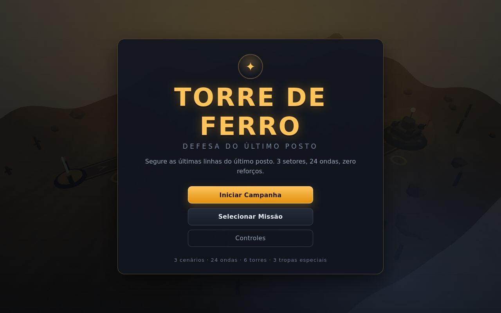
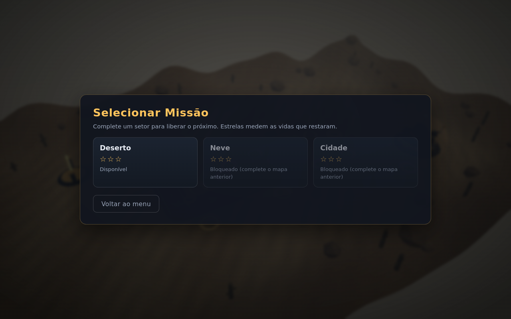
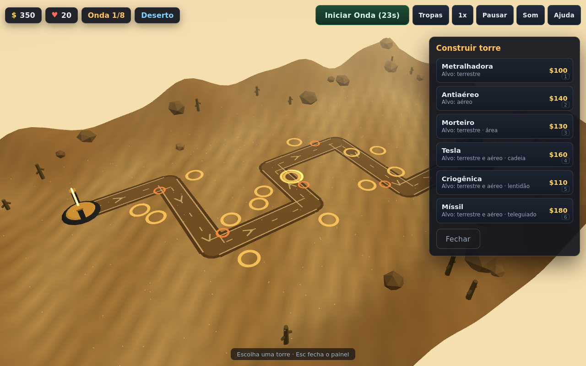
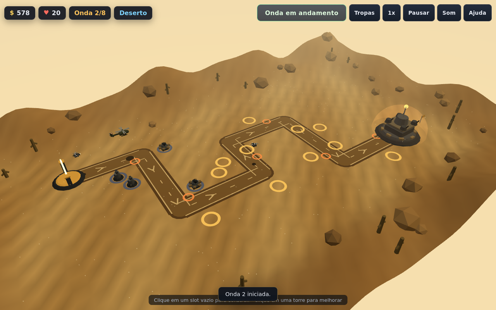
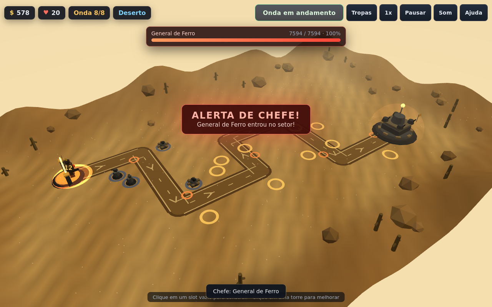
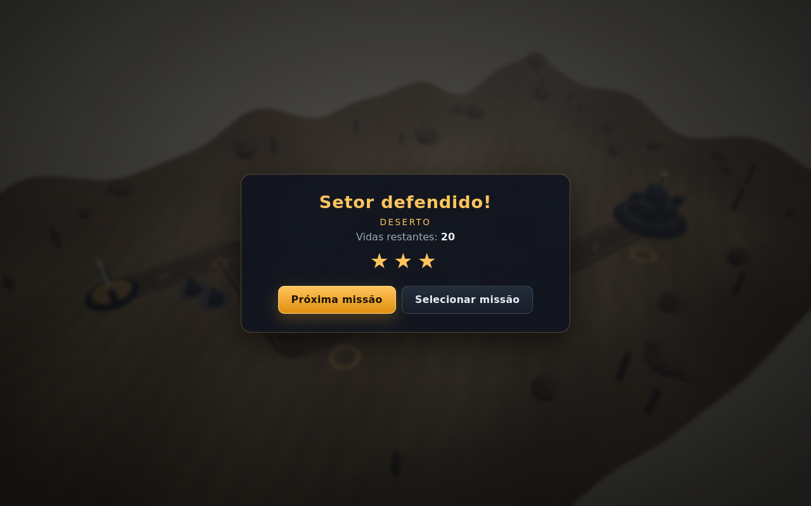

# Torre de Ferro — Defesa do Último Posto

Jogo 3D de **defesa de torre** no navegador, em pt-BR, feito para rodar **sem build e
sem dependências**: `node serve.mjs` servindo a pasta e o jogo abre em
`http://127.0.0.1:8099/`. WebGL via Three.js vendorizado, simulação pura em módulos
ES, áudio 100% sintetizado com WebAudio (zero arquivo de áudio) e efeitos procedurais
(sem imagens/modelos externos).

- **3 cenários × 8 ondas = 24 ondas** (Deserto, Neve, Cidade), com chefes nas ondas
  8, 16 e 24.
- **10 inimigos**, sendo **4 aéreos** (drones desde a onda 2; chefes aéreos na Neve).
- **6 torres** com 3 níveis e comportamentos distintos (instantâneo, splash, cadeia,
  lentidão, míssil teleguiado) e **3 tropas especiais** posicionáveis.
- Economia com caixa e vidas por mapa, estrelas, desbloqueio progressivo e save em
  `localStorage`; tutorial de 6 passos no Deserto.
- Passo fixo de `1/60 s`, pausa, velocidade 1×/2× e `fastForward` para QA.

## Screenshots

Capturas reais do jogo rodando em Chromium headless (1280×800, geradas por
`node tests/browser-check.mjs`):

| | |
|---|---|
|  |  |
| Menu — `menu.png` | Seleção de missão — `missoes.png` |
|  |  |
| Painel Construir com as 6 torres — `kit-construir.png` | Onda com inimigos aéreos — `batalha-aereos.png` |
|  |  |
| Chefe com barra de vida — `chefe-painel.png` | Tela de vitória — `vitoria.png` |

Arquivos individuais: [`menu.png`](docs/screenshots/menu.png) ·
[`missoes.png`](docs/screenshots/missoes.png) ·
[`kit-construir.png`](docs/screenshots/kit-construir.png) ·
[`batalha-aereos.png`](docs/screenshots/batalha-aereos.png) ·
[`chefe-painel.png`](docs/screenshots/chefe-painel.png) ·
[`vitoria.png`](docs/screenshots/vitoria.png) ·
[`derrota.png`](docs/screenshots/derrota.png).

## Como rodar

Requisito: **Node.js 18+** (só para o servidor estático; o jogo em si é HTML/JS puro)
e um navegador com WebGL habilitado (Chrome/Edge/Firefox recentes).

```bash
cd games/torre-de-ferro
node serve.mjs          # imprime http://127.0.0.1:8099/ (porta padrão)
node serve.mjs 9000     # porta alternativa: http://127.0.0.1:9000/
```

Abra a URL impressa no navegador. Não há `npm install`, bundler, backend nem
requisição externa: o servidor é Node stdlib (só `http`/`fs`/`path`) e todos os
assets do jogo são arquivos locais ou sintetizados em runtime.

O servidor entrega MIME correto, `Cache-Control: no-store`, `404` para caminho
inexistente e bloqueia tentativas de path traversal (`..`, `%2e%2e`). `/` serve o
`index.html`. Ele também responde `204` em `/favicon.ico` para o Chromium não
registrar um `404` de console.

## Controles

| Ação | Controle |
|---|---|
| Orbitar a câmera | arrastar com o botão esquerdo |
| Deslocar (pan) | arrastar com o botão direito |
| Zoom | roda do mouse |
| Construir torre no slot | clique no slot vazio (abre o painel Construir) |
| Abrir painel da torre | clique em uma torre construída |
| Construir pela tecla | `1` metralhadora · `2` antiaéreo · `3` morteiro · `4` tesla · `5` criogênica · `6` míssil |
| Posicionar tropa | `7` fuzileiros · `8` antiaérea · `9` sniper (ou painel Tropas → Posicionar) |
| Melhorar torre | `U` (ou botão Melhorar no painel da torre) |
| Vender torre | `V` (devolve 70% do total investido) |
| Pausar / retomar | `Espaço` (ou botão Pausar / Continuar) |
| Velocidade 1× / 2× | `F` (ou botão 1x/2x) |
| Mudo / som | `M` (ou botão Som) |
| Iniciar a próxima onda | `N` (ou botão Iniciar Onda; a preparação também começa sozinha em 25 s) |
| Ajuda | `H` |
| Fechar painel / voltar | `Esc` |

## Conteúdo do jogo

**Mapas e ondas.** Deserto (ondas 1–8), Neve (9–16) e Cidade (17–24); chefe no fim
de cada mapa. Onda = grupos de inimigos com atraso inicial; termina quando a fila de
spawn esvazia e não há inimigo vivo. Bônus ao concluir: `25 + 10 × onda`.

**Inimigos** (valores base finais na onda 1, após o balanceamento autorizado pelo
dono da issue — ver "Balancete final (divergências da especificação)": HP base ×0,84
e recompensa ×1,15 sobre a issue; HP escala `round(HP × (1 + 0,18 × (onda−1)))`,
dano, velocidade e recompensa não escalam):

| Inimigo | Classe | HP | Vel. (u/s) | Dano à base | Recompensa |
|---|---|---|---|---|---|
| Soldado | terrestre | 50 | 3,2 | 1 | $9 |
| Blindado | terrestre | 168 | 2,2 | 1 | $21 |
| Tanque | terrestre | 546 | 1,6 | 2 | $52 |
| Drone | **aéreo** | 38 | 4,0 | 1 | $12 |
| Helicóptero | **aéreo** | 210 | 3,0 | 1 | $35 |
| Bombardeiro | **aéreo** | 672 | 1,8 | 2 | $81 |
| Zepelim | **aéreo** | 1512 | 0,9 | 5 | $173 |
| General de Ferro (chefe do Deserto) | chefe terrestre | 3360 | 1,4 | 10 | $460 |
| Fortaleza Voadora (chefe da Neve) | **chefe aéreo** | 5880 | 0,8 | 10 | $1035 |
| Mecha Titã (chefe da Cidade) | chefe terrestre | 10080 | 1,1 | 10 | $2300 |

Chefes têm 50% de resistência a lentidão, não são bloqueados por tropas e atacam
tropas em um raio de 2,5 u.

**Torres** (custo L1/L2/L3; dano/cadência/alcance por nível):

| Torre | Alvo | Custo | Dano | Cadência (s) | Alcance | Efeito |
|---|---|---|---|---|---|---|
| Metralhadora | terrestre | 100/80/140 | 12/22/36 | 0,60/0,50/0,40 | 14/15/16 | instantâneo |
| Antiaéreo | aéreo | 140/110/180 | 30/55/90 | 1,00/0,90/0,75 | 18/19/20 | instantâneo |
| Morteiro | terrestre | 130/100/160 | 45/80/140 | 1,80/1,60/1,40 | 16/17/18 | splash 4,0/4,5/5,0 u |
| Tesla | terrestre+aéreo | 160/130/190 | 28/46/74 | 1,20/1,10/0,95 | 12/12/13 | cadeia 2/3/4, salto ≤ 6 u, ×0,7 por salto |
| Criogênica | terrestre+aéreo | 110/90/130 | 6/10/16 | 0,80/0,80/0,80 | 13/14/16 | lentidão 25/35/45% por 1,5/2,0/2,5 s (teto 60%) |
| Míssil | terrestre+aéreo | 180/150/220 | 70/120/210 | 2,60/2,40/2,20 | 22/23/24 | teleguiado 14 u/s, splash 3 u ao explodir |

Venda devolve 70% do investido e libera o slot; construir durante a onda é
permitido. Alvo = inimigo compatível no alcance com maior progresso (empate: menor id).

**Tropas especiais** (máximo 1 de cada tipo viva por vez):

| Tropa | Custo | HP | Alcance | Dano | Intervalo | Alvo | Vida útil | Recarga |
|---|---|---|---|---|---|---|---|---|
| Esquadrão de Fuzileiros | $90 | 500 | 8 | 10 | 0,60 s | terrestre | 40 s | 45 s |
| Equipe Antiaérea | $70 | 300 | 16 | 22 | 0,80 s | aéreo | 35 s | 40 s |
| Sniper de Elite | $110 | 250 | 30 | 150 | 2,50 s | terrestre+aéreo | 30 s | 35 s |

Fuzileiros bloqueiam até 4 terrestres num raio de 2,0 u; o sniper prioriza o
inimigo com maior HP e as demais tropas o de maior progresso.

**Economia, vidas e estrelas.** Caixa inicial por mapa (`START_MONEY_PER_MAP`):
**$350 no Deserto, $350 na Neve e $800 na Cidade** — não transporta entre mapas —
e 20 vidas por mapa. Dinheiro nunca fica negativo; a recompensa do abate cai na
hora. Estrelas ao vencer: 3 = 20 vidas, 2 = 14–19, 1 = 1–13, 0 = derrota. Deserto é
livre; Neve exige Deserto vencido; Cidade exige Neve vencida.

**Save.** Chave `td3d:save:v1` no `localStorage`, validada no boot (deep merge com
defaults): `{version:1, tutorialDone, settings:{volume,muted,speed},
maps:{deserto|neve|cidade:{unlocked,stars,wavesWon,bestLives}},
totals:{kills,waves,timePlayed}}`. Não existe save no meio da partida — apenas
progresso entre partidas.

**Áudio e efeitos.** WebAudio 100% sintetizado (tiros, impactos, inimigos, UI e uma
trilha de 8 compassos a 96 BPM com camada extra no chefe), sem nenhum arquivo de
áudio. O `AudioContext` só é criado no primeiro gesto (clique/tecla). Efeitos
procedurais em Three.js: explosões, rastro de míssil, flashes com point lights
limitadas, dano flutuante, hit flash, cadeia tesla, tinta/gelo de lentidão, screen
shake e clima por mapa (areia, neve, brasas).

## Estrutura

```
games/torre-de-ferro/
├── index.html              # telas (menu, missões, partida, pausa, vitória, derrota, ajuda, controles)
├── styles.css              # tema escuro, HUD e painéis (pt-BR)
├── package.json            # type module, scripts; ZERO dependências
├── serve.mjs               # servidor HTTP estático (Node stdlib; 127.0.0.1:8099)
├── README.md               # este arquivo
├── src/
│   ├── main.js             # boot, loop, telas, save, handlers da HUD e window.__TD__ (QA)
│   ├── sim/                # simulação pura: sem DOM, Three ou áudio
│   │   ├── rng.js          # mulberry32(20261109) — determinismo
│   │   ├── data.js         # tabelas canônicas, save (validateSave/createDefaultSave)
│   │   ├── maps.js         # 3 mapas: waypoints, slots, pontos de tropa, pathPointAt
│   │   ├── waves.js        # as 24 ondas exatas
│   │   ├── combat.js       # alvo/tiro/splash/cadeia/lentidão/míssil
│   │   ├── troops.js       # tropas, bloqueio, vida útil e recarga
│   │   └── engine.js       # passo fixo 1/60 s, fila de eventos, economia, vitória/derrota
│   └── render/             # tudo o que toca DOM/Three/WebAudio
│       ├── scene.js        # cena, câmera, picking, clima, update/render, perf()
│       ├── meshes.js       # modelos procedurais (inimigos, torres, tropas, terreno)
│       ├── fx.js           # partículas/efeitos a partir dos eventos
│       ├── hud.js          # telas, HUD, painéis, tutorial, toasts (só DOM)
│       └── audio.js        # WebAudio sintetizado (sem arquivos)
├── src/vendor/three/       # three.module.js (0.160.0) + LICENSE (MIT)
├── tests/
│   ├── simulate.mjs        # simulação headless + bot de referência (Deserto/Neve/Cidade)
│   ├── static-check.mjs    # checagens estáticas + serve.mjs (HTTP 200/404, MIME, no-store)
│   └── browser-check.mjs   # Chromium headless: joga via __TD__, valida WebGL, captura screenshots
└── docs/screenshots/       # capturas reais + baseline "antes" do PR
```

**Arquitetura em uma frase:** `src/sim/` é pura e determinística, avança em passos
fixos de 1/60 s e emite uma fila de eventos; `src/main.js` consome essa fila
distribuindo para `render/scene.js` (visual), `render/fx.js` (partículas),
`render/audio.js` (som) e `render/hud.js` (DOM), sem que render/HUD chamem a
simulação diretamente.

## Testes

Rode em `games/torre-de-ferro/` (Node 18+):

```bash
node tests/simulate.mjs             # < 10 s, exit 0 — determinismo, 24 ondas, HP escalado,
                                    # torres/níveis/venda, tropas/bloqueio/recarga, economia/vidas,
                                    # derrota sem torres, bot de referência vence o Deserto (vidas>=15)
node tests/simulate.mjs --completo  # < 60 s, exit 0 — bot vence os 3 mapas
                                    # (Deserto 20, Neve 8, Cidade 7 vidas)
node tests/static-check.mjs         # exit 0 — arquivos da arquitetura, Three.js > 500 KB + LICENSE,
                                    # zero URL externa, zero mídia, imports resolvem, node --check,
                                    # UI pt-BR, window.__TD__, HTTP 200/404 do serve.mjs (MIME/no-store),
                                    # sem node_modules e nenhum arquivo alterado fora do escopo
node serve.mjs                      # imprime http://127.0.0.1:8099/ e responde 200
node tests/browser-check.mjs        # exit 0 — abre Chromium headless, joga o Deserto via __TD__,
                                    # valida 0 erro de console, 0 request externo, WebGL renderizando,
                                    # telas, save/tutorialDone, áudio/fx/eventos e captura os screenshots
```

`static-check.mjs` sobe o `serve.mjs` de verdade numa porta livre e confere `200` em
`/`, `/index.html`, `/styles.css`, `/src/main.js` e no Three.js vendorizado, `404` em
`/nao-existe`, `Cache-Control: no-store` e bloqueio de path traversal.

`browser-check.mjs` usa Playwright **opcional** (`playwright`/`playwright-core` via
`NODE_PATH`, `PLAYWRIGHT_PATH` ou o caminho padrão `/tmp/pw/node_modules`; Chromium em
`CHROMIUM_PATH` ou no cache do Playwright). Sem Playwright ele imprime
`SKIP: playwright indisponível` e sai com `0` — o restante do harness continua
funcionando sem navegador. Neste ambiente, a execução usada como evidência foi:

```bash
NODE_PATH=/tmp/pw/node_modules \
CHROMIUM_PATH=/root/.cache/ms-playwright/chromium-1134/chrome-linux/chrome \
node tests/browser-check.mjs
```

Para recapturar a evidência "antes" do PR (página inexistente no `main`):

```bash
node tests/browser-check.mjs --antes   # extrai origin/main p/ tmp, serve e captura
                                       # docs/screenshots/antes-404.png (HTTP 404)
```

## Origem e versão do Three.js

- **Versão:** three.js **0.160.0** (`REVISION = '160'`), vendorizado em
  `src/vendor/three/three.module.js` (1,21 MiB) + `src/vendor/three/LICENSE` (MIT).
- **Origem:** `https://unpkg.com/three@0.160.0/build/three.module.js`, baixado **uma
  única vez em ambiente de desenvolvimento em 09/11/2026** e versionado no repo.
- **SHA-256** do `three.module.js` vendorizado:
  `76dea8151bc9352aef3528b4262e249b2604f62543828328db978d060d61a495`.
- **Runtime sem requisição externa:** nenhum CDN, nenhuma URL `http(s)` no
  `index.html` ou em `src/` fora do vendor; o harness verifica isso.

## Evidência antes/depois do PR

Como o jogo é uma pasta nova dentro de `games/`, o "antes" é simplesmente a página
não existir no `main`: servindo a árvore do `main` e abrindo
`/games/torre-de-ferro/`, a resposta é **HTTP 404** (ver
[`docs/screenshots/antes-404.png`](docs/screenshots/antes-404.png)). O "depois" são
as telas reais do jogo listadas no topo deste README, capturadas pelo
`browser-check.mjs` no jogo integrado.

## Limitações honestas

- **Sem save no meio da partida:** o `localStorage` guarda só progresso entre
  partidas (estrelas, desbloqueio, tutorial, ajustes) — sair no meio perde a
  partida.
- **Som não auditável em headless:** o harness valida o grafo de áudio e o
  `audioLog`, mas em Chromium headless (e em máquina sem dispositivo de áudio) não
  há som audível para um humano. A trilha/efeitos existem e tocam em navegador normal.
- **`/favicon.ico` responde 204 (exceção intencional ao 404):** o Chromium pede o
  favicon sozinho e um 404 gerava `console.error`; o critério de aceite exige zero
  erro de console. Não é asset do jogo nem toca em arquivo existente.
- **Tutorial só no Deserto:** os 6 passos aparecem apenas na primeira partida do
  Deserto, enquanto `tutorialDone` for falso (comportamento da especificação).
- **Depende de WebGL:** sem WebGL o jogo mostra um aviso legível em vez da cena 3D.
- **Screenshots geradas em headless com SwiftShader:** cores/iluminação podem
  variar levemente em GPU real; as imagens são capturas reais, não montagens.
- **`browser-check.mjs` depende de Playwright externo:** ele não está no repo (sem
  dependências); sem Playwright o teste é `SKIP` e sai com 0. Neste ambiente foi
  possível rodar com o Playwright/Chromium descritos acima.
- **Sem backend, multijogador, telemetria ou pós-processamento (bloom):** por
  design do escopo — o jogo é estático e offline após o carregamento.
- **UI de toque/mobile não é alvo:** os controles são mouse + teclado; telas
  pequenas podem ficar apertadas (layout otimizado para desktop, 1280×800+).

## Balancete final (divergências da especificação)

O dono da issue **autorizou explicitamente** um balanceamento além da cláusula de
escape original de ±20%, no comentário
[#issuecomment-6755919919](https://github.com/dshsuperagent-oss/superagent-sandbox/issues/18#issuecomment-6755919919),
depois de medido que a Cidade era invencível com os números fechados. É este o
ajuste aplicado em `src/sim/data.js` (e refletido nas tabelas acima).

### Inimigos — HP base e recompensa (original → novo)

| Inimigo | HP base | Recompensa |
|---|---|---|
| Soldado | 60 → 50 | $8 → $9 |
| Blindado | 200 → 168 | $18 → $21 |
| Tanque | 650 → 546 | $45 → $52 |
| Drone | 45 → 38 | $10 → $12 |
| Helicóptero | 250 → 210 | $30 → $35 |
| Bombardeiro | 800 → 672 | $70 → $81 |
| Zepelim | 1800 → 1512 | $150 → $173 |
| General de Ferro (chefe do Deserto) | 4000 → 3360 | $400 → $460 |
| Fortaleza Voadora (chefe da Neve) | 7000 → 5880 | $900 → $1035 |
| Mecha Titã (chefe da Cidade) | 12000 → 10080 | $2000 → $2300 |

### Caixa inicial por mapa (original → novo)

| Mapa | Caixa inicial | Observação |
|---|---|---|
| Deserto | $350 → $350 | inalterada |
| Neve | $350 → $350 | inalterada |
| Cidade | $350 → **$800** | nova tabela `START_MONEY_PER_MAP` |

**Nenhum outro número foi alterado:** bônus de onda (`25 + 10×onda`), fórmula de HP
(`round(HP × (1 + 0,18×(onda−1)))`), composição e intervalos das 24 ondas,
custos/dano/cadência/alcance/efeitos das 6 torres, tropas, vidas iniciais (20),
estrelas e venda (70%) permanecem exatamente como na especificação.

### Bot de referência — antes → depois (medido)

| Mapa | Números originais da issue | Ajuste intermediário ±20% (HP ×0,80, $×1,20) | **Final (HP ×0,84, $×1,15, caixa Cidade $800)** |
|---|---|---|---|
| Deserto | vitória com **10 vidas** | vitória com 20 vidas | **vitória com 20 vidas** |
| Neve | **derrota na onda 11** (0 vidas) | vitória com 11 vidas | **vitória com 8 vidas** |
| Cidade | **derrota na onda 18** (0 vidas) | derrota na onda 18 (0 vidas) | **vitória na onda 24, com 7 vidas** |

Margens exigidas pelo dono da issue — **Deserto ≥ 15, Neve ≥ 8, Cidade ≥ 3** —
**cumpridas** (20 / 8 / 7).

### Motivo do ajuste

- Com a caixa fixa de $350, a **Cidade era invencível**: na onda 17 o HP global é
  **3,88×** (1 + 0,18×16) e as recompensas não escalam. Medido, o piso era 12 de
  dano na onda 17 e 6 na onda 18, sobrando ≤ 2 vidas — nenhuma composição de
  compras disponível evitava a derrota.
- O autor da issue **autorizou explicitamente** o balanceamento além do ±20% no
  comentário #issuecomment-6755919919.
- A caixa de **$800 na Cidade** é o **menor valor testado com margem ≥ 4** sobre o
  critério (o bot vence com 7 vidas); a Cidade continua mais difícil que a Neve
  mesmo com esse reforço.

Saída real do bot (`node tests/simulate.mjs` / `--completo`):

```
node tests/simulate.mjs            # exit 0 — 40 checagens, 40 PASS
BOT deserto: vitória=true vidas=20 onda=8 kills=123 vazamentos=0
node tests/simulate.mjs --completo # exit 0 — 43 checagens, 43 PASS
BOT deserto: vitória=true vidas=20 onda=8 kills=123 vazamentos=0
BOT neve:    vitória=true vidas=8  onda=16 kills=101 vazamentos=12
BOT cidade:  vitória=true vidas=7  onda=24 kills=144 vazamentos=3
```

## API de QA (`window.__TD__`)

Página de jogo expõe uma API para testes automatizados e depuração no console:

```js
start({mapId,seed,money,lives}), state(), eventLog(n), spawnWave(n), spawnEnemy(type,count),
giveMoney(v), setLives(v), setSpeed(1|2), pause(), resume(), fastForward(s),
buildTower(slot,type), upgradeTower(id), sellTower(id), deployTroop(type,point),
audioLog(n), fxLog(n), perf(), win(), lose()
```

`state()` devolve um snapshot serializável (JSON) com mapa, onda, fase, economia,
inimigos, torres, tropas, projéteis, slots, pontos de tropa, estatísticas e chefe.
