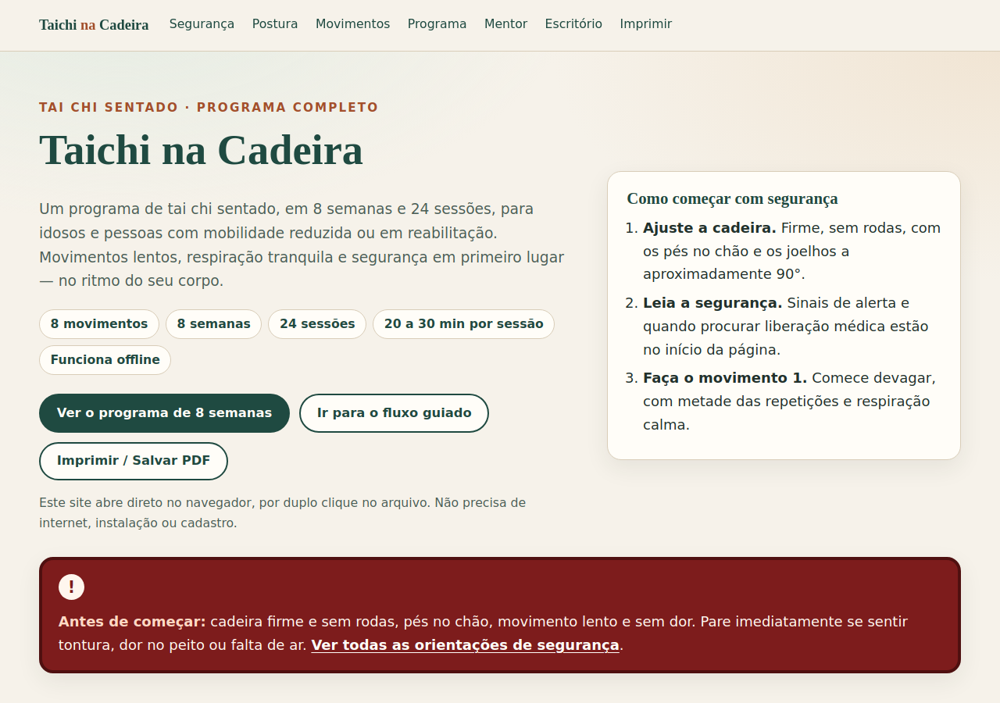
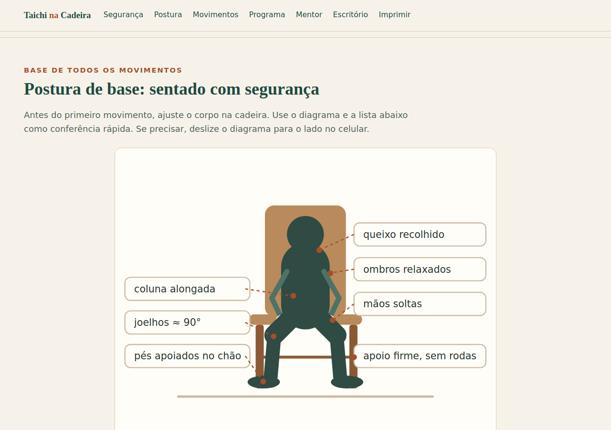
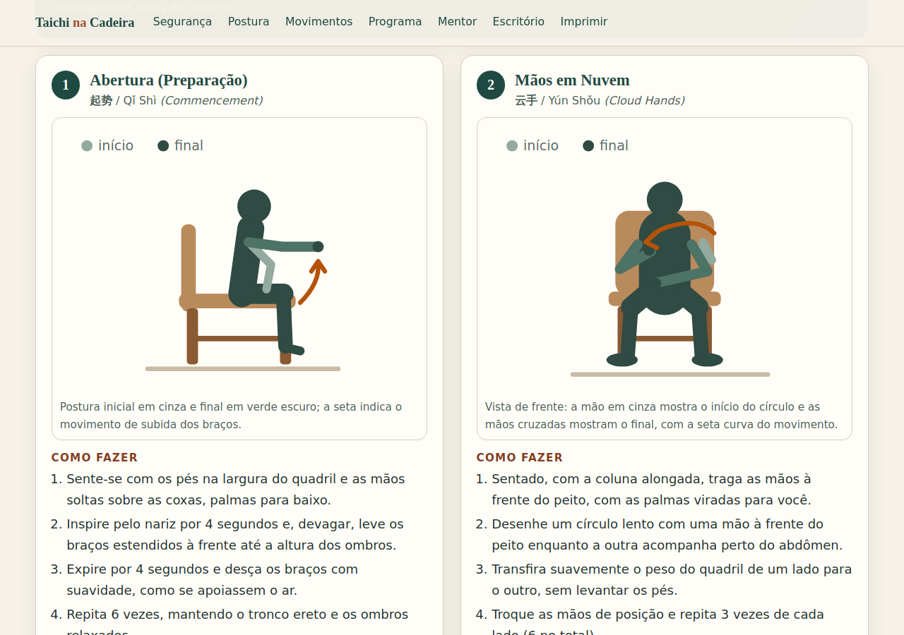

# Taichi na Cadeira

Programa completo de **taichi na cadeira (tai chi sentado)**, em português do Brasil,
pensado para **idosos** e **pessoas com mobilidade reduzida ou em reabilitação** — com
uma trilha curta de adaptação para **pausas na cadeira de trabalho**.

É um **site estático de arquivo único**: `index.html` reúne HTML, CSS, JavaScript e as
ilustrações em SVG inline. **Zero CDN, zero npm, zero build, zero mídia externa e zero
requisição de rede em runtime** — abre por duplo clique, inclusive **offline**.

- **8 movimentos** ilustrados em SVG (com cadeira, setas de direção e postura
  inicial/final), mais **1 diagrama de postura sentada** com marcações — 9 SVGs no total.
- **Programa de 8 semanas × 3 sessões = 24 sessões**, de **20 a 30 minutos** cada
  (aquecimento 5 min → sequência principal 15–20 min → resfriamento 5 min).
- **Guia do mentor**: papel, check-in 2×/semana, roteiro de sessão guiada, registro
  semanal (escala 1–5 em equilíbrio, conforto, respiração, energia e sono), critérios de
  progressão e de regressão.
- **Segurança com destaque visual**: cadeira firme e sem rodas, pés no chão, movimento
  lento e sem dor, sinais de alerta e quando buscar liberação médica.
- **Versão escritório**: pausas de 3–5 minutos a cada 60–90 minutos, com orientações de
  postura na cadeira de trabalho.
- **Modo de fluxo contínuo** opcional (8 movimentos guiados por respiração, com pausa,
  avançar e parar) e **versão para imprimir/PDF**, incluindo uma **folha de bolso de uma
  página** só para impressão.

## Como abrir (leitor)

1. Baixe ou clone a pasta `taichi-na-cadeira/`.
2. Dê **duplo clique em `index.html`** (ou arraste o arquivo para uma aba do navegador).
   Não é preciso servidor, instalação, internet ou cadastro.
3. Leia primeiro a seção **Segurança** e confira a **postura de base** sentrado.
4. Siga a tabela do programa: oito semanas, três sessões por semana, 20 a 30 minutos.
5. Se quiser praticar com a página conduzindo o ritmo, use **Ir para o fluxo guiado**.
6. Para levar o programa para o papel ou celular, use **Imprimir / Salvar PDF**; no
   diálogo de impressão, escolha **Salvar como PDF**. A folha de bolso de uma página sai
   primeiro, e o programa completo vem na sequência.

## Como usar (mentor)

O mentor pode ser um familiar, cuidador, fisioterapeuta ou profissional de educação
física. Ele acompanha, encoraja e registra — sem substituir a avaliação de saúde.

1. **Leia o “Guia do mentor”** e o roteiro de sessão guiada (intenção → demonstração →
   prática com correção → revisão).
2. **Faça dois check-ins por semana**: no início (como a pessoa está, objetivo da semana)
   e no fim (o que foi fácil, o que foi difícil, o que ajustar).
3. **Preencha o registro semanal** na tela ou imprima a página e anote à mão:
   equilíbrio, conforto, respiração, energia e sono, de 1 a 5.
4. **Use os critérios de progressão e de regressão** do guia: sem dor e sem perder o
   fôlego, progrida; com dor, tontura ou cansaço excessivo, reduza repetições e amplitude.
5. **Preserve a autonomia**: das últimas semanas em diante, o praticante conduz a sessão e
   o mentor observa e registra.

> **Aviso:** este material é educativo e de apoio à prática. **Não substitui avaliação
> médica ou fisioterapêutica**, nem serve para diagnosticar, tratar ou curar condições de
> saúde. Em caso de dúvida, procure um profissional.

## Screenshots

Capturas reais do site renderizado em **Chromium headless** (viewport 1280×900, geradas
por `node tests/capture.cjs` a partir de `file://`):

| Topo/hero | Diagrama de postura | Cartões de movimento |
|---|---|---|
|  |  |  |
| `prints/01-topo-hero.png` | `prints/02-diagrama-postura.png` | `prints/03-cartoes-movimentos.png` |

## Estrutura

```text
taichi-na-cadeira/
  index.html                  site completo em arquivo único (CSS, JS e 9 SVGs inline)
  pesquisa.md                 pesquisa que embasa o conteúdo (35 fontes com URL)
  README.md                   este arquivo
  prints/                     3 capturas reais (PNG 1280×900) do site renderizado
  tests/
    browser-check.cjs         verificador de aceite (Chromium headless, 42 checagens)
    capture.cjs               gerador determinístico das capturas de prints/
```

Os scripts em `tests/` são **ferramenta de desenvolvimento** (Node 22 + Chromium via
Playwright); o site em si continua sendo um único arquivo sem nenhuma dependência.

## Testes (somente desenvolvimento)

O JavaScript inline pode ser validado sem abrir o navegador:

```bash
python3 - <<'PY'
import re
html = open('taichi-na-cadeira/index.html', encoding='utf-8').read()
open('/tmp/taichi-script.js', 'w', encoding='utf-8').write(
    re.search(r'<script>(.*?)</script>', html, re.S).group(1))
PY
node --check /tmp/taichi-script.js
```

A verificação de aceite e as capturas usam Chromium headless (Playwright como ferramenta
de desenvolvimento, não dependência do site):

```bash
NODE_PATH=/tmp/pw/node_modules node taichi-na-cadeira/tests/browser-check.cjs
NODE_PATH=/tmp/pw/node_modules node taichi-na-cadeira/tests/capture.cjs
```

`browser-check.cjs` confere, entre outras coisas: **exatamente 9 `<svg>`** visíveis e com
nome acessível; os 8 cartões (nome pt-BR, chinês/pinyin, como fazer com 3–5 passos,
respiração, repetições e dica de segurança); as **24 sessões em 8 semanas**; guia do
mentor (registro 1–5 nas cinco dimensões, check-in 2×/semana, progressão e regressão);
segurança (aviso médico e sinais de alerta); trilha de escritório; `@media print`; corpo
com **18 px**; abertura por `file://` **sem erro de console, sem requisição externa** e
`node --check` limpo no script extraído. `capture.cjs` regenera as três imagens de
`prints/`.

## Limitações honestas

- O material é **educativo** e não substitui avaliação médica, fisioterapêutica ou de
  outro profissional de saúde.
- A evidência da versão **sentada** do tai chi é menor e mais recente que a da versão em
  pé; o programa **não promete** prevenção de quedas nem ganho de massa muscular. As 8
  semanas são um **ciclo inicial** — a pesquisa discute a dose e a progressão esperada.
- A respiração 4-4 é uma convenção didática confortável, **não** um protocolo com ensaio
  clínico específico; o importante é não prender a respiração.
- O registro semanal na tela **não é salvo** ao recarregar a página: use a impressão/PDF
  ou anote o registro à mão.
- A acessibilidade foi validada programaticamente (nomes acessíveis, contraste, legendas
  de tabela, foco, tamanho de fonte e navegação por âncoras), mas **não** com uma sessão
  real de leitor de tela (NVDA/TalkBack/VoiceOver).
- As ilustrações são **flat e simplificadas** — legíveis e didáticas, não fotorrealistas.
- O layout foi validado em Chromium headless (desktop 1280 e mobile 390); comportamentos
  específicos de Safari/Firefox muito antigos não foram testados.
- Sem backend, sem cadastro, sem coleta de dados e sem telemetria: todo o conteúdo é
  local ao arquivo.

## Pesquisa

O levantamento que embasa as decisões de conteúdo está em
[`pesquisa.md`](pesquisa.md): programas existentes, evidência por desfecho (equilíbrio,
quedas, força/função, dor, populações especiais), adaptações, contraindicações e
segurança, lacunas das ofertas atuais e limitações da própria pesquisa — com **35 fontes
com URL** e status de verificação de cada uma (11/11/2026).

## Relação com a especificação (issue #21)

Nenhuma divergência nos valores pedidos: nomes dos movimentos, chinês/pinyin, respiração,
repetições, duração (8 semanas × 3 = 24 sessões, 20–30 min), estrutura da sessão, escala
1–5, check-in 2×/semana, critérios de progressão/regressão e conteúdo de segurança foram
mantidos como especificados. Fora da pasta `taichi-na-cadeira/`, apenas **uma linha** foi
acrescentada ao `README.md` raiz apontando para este programa.
