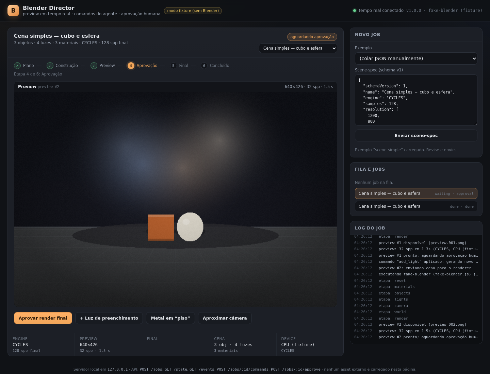

# Blender Director

MVP de um "diretor de cena" para o agente: recebe um **scene-spec JSON**,
constrói a cena no Blender, mostra um **preview em tempo real** para o usuário,
aceita **comandos incrementais** (luz, material, câmera) e só libera o **render
final** depois de uma aprovação humana.

Roda com **Node 22 stdlib apenas** — sem `npm install`, sem CDN e sem asset
externo obrigatório. O Blender real é opcional: um `fake-blender` determinístico
permite desenvolver o viewer e rodar o e2e em qualquer máquina Linux, mesmo
sem o Blender instalado.



## O que entra e o que sai

- Entra: cena declarativa (objetos, materiais PBR, luzes, câmera, mundo,
  color management, samples, resolução) — contrato em [`schema.md`](schema.md).
- Sai: previews PNG numerados, `manifest.json` com métricas, `scene.blend`,
  render final e eventos de progresso por SSE.
- O viewer mostra etapa atual, preview auto-atualizado, métricas, logs e o
  botão **Aprovar render final**.

## Fluxo completo

1. O agente monta o **scene-spec** (JSON) e chama `POST /jobs`.
2. O servidor valida, aplica defaults, cria `runs/<job>/spec.json` e enfileira.
3. O `build.py` roda headless no Blender, constrói a cena, salva `scene.blend`
   e renderiza o **preview** (padrão 640 px, 32 spp).
4. O viewer recebe o estado por SSE, mostra o preview e libera **comandos
   incrementais**; cada comando gera um novo preview e invalida a aprovação.
5. O usuário clica em **Aprovar render final**; o `build.py` reabre o
   `scene.blend` e renderiza o **final** (resolução/samples do spec). O
   `manifest.json` registra tempos, samples, engine e GPU/CPU.

## Como funciona

```text
 agente / DSH / curl
        │  POST /jobs (scene-spec)
        ▼
 ┌──────────────────┐      fila (1 job por vez)      ┌────────────────────┐
 │    server.js     │ ─────────────────────────────▶ │    renderer.js     │
 │ HTTP + SSE + job │                                │  spawn + JSONL     │
 └────────┬─────────┘                                └─────────┬──────────┘
          │                                                     │
          │  GET /events (SSE: estado completo a cada mudança)   ├─ blender -b -P build.py   (real)
          ▼                                                     └─ fake-blender.js          (fixture)
 ┌──────────────────┐
 │  viewer/index    │ ◀── preview PNG, timeline, logs, botões
 └──────────────────┘
          │  POST /jobs/:id/commands   → aplica comando e gera novo preview
          │  POST /jobs/:id/approve    → libera o render final
          ▼
        done/error
```

Etapas exibidas no viewer: `plan → build → preview → approval → final → done`.
O job fica em `approval/waiting` entre o preview e a aprovação; é a única janela
em que comandos incrementais são aceitos.

### Eventos entre `build.py` e o servidor

O `build.py` roda dentro do Blender e escreve **uma linha JSON por evento** no
`stdout`:

```json
{"event":"step","name":"objects"}
{"event":"preview","file":"preview-001.png"}
{"event":"metric","stage":"preview","samples":32,"seconds":1.8,"engine":"CYCLES","device":"GPU","resolution":[640,426]}
{"event":"final","file":"final-001.png"}
```

O `renderer.js` repassa cada evento ao servidor, que atualiza o job e publica
o estado por SSE. Mensagens humanas do Blender vão para o `stderr` e viram log.

## Requisitos

- **Node 22+** (usa `fetch`, `AbortController`, `node:test` não é necessário).
- **Blender 5.2.3 LTS** para render real (alvo: Windows + RTX 3060 12 GB +
  Cycles/OptiX). Não é necessário para o modo fixture.
- Nenhuma dependência de runtime.

## Início rápido (sem Blender)

```bash
node tools/blender-director/server.js --fake-blender
```

Abra <http://127.0.0.1:8137/>. O viewer já vem com o exemplo `scene-simple`
carregado; clique em **Enviar scene-spec**. O preview aparece em instantes,
o botão **Aprovar render final** habilita, e o render final "renderiza" em
seguida. O modo fixture gera PNGs placeholder determinísticos e métricas
fictícias — serve para validar o fluxo, não a imagem.

A mesma coisa pela API:

```bash
# 1. cria o job
curl -s -X POST http://127.0.0.1:8137/jobs \
  -H "Content-Type: application/json" \
  --data-binary @tools/blender-director/examples/scene-simple.json

# 2. acompanha (ou conecte em GET /events para SSE)
curl -s http://127.0.0.1:8137/state

# 3. comando incremental (job em approval/waiting)
curl -s -X POST http://127.0.0.1:8137/jobs/<id>/commands \
  -H "Content-Type: application/json" \
  --data-binary @tools/blender-director/examples/command-add-light.json

# 4. aprova o render final
curl -s -X POST http://127.0.0.1:8137/jobs/<id>/approve
```

No Windows, `curl.exe` existe no Windows 10/11; em PowerShell também dá para
usar `Invoke-RestMethod`:

```powershell
$spec = Get-Content .\tools\blender-director\examples\scene-simple.json -Raw
$job  = Invoke-RestMethod -Method Post -Uri http://127.0.0.1:8137/jobs `
          -ContentType 'application/json' -Body $spec
Invoke-RestMethod -Method Post -Uri "http://127.0.0.1:8137/jobs/$($job.id)/approve"
```

## Windows com Blender real

1. Instale o **Blender 5.2 LTS** e confirme que `blender.exe` abre.
2. Rode o servidor apontando para o executável (aspas por causa dos espaços):

```powershell
node tools\blender-director\server.js `
  --blender "C:\Program Files\Blender Foundation\Blender 5.2\blender.exe"
```

Também é possível definir `BLENDER_BIN` no ambiente:

```powershell
$env:BLENDER_BIN = "C:\Program Files\Blender Foundation\Blender 5.2\blender.exe"
node tools\blender-director\server.js
```

3. Verifique no log se o OptiX foi ativado. O `build.py` tenta, nesta ordem,
   `OPTIX`, `CUDA`, `HIP`, `ONEAPI`, `METAL`; se não achar dispositivo, cai para
   CPU com um `warning`, sem falhar o job. O `manifest.json` registra
   `device` e `devices`.
4. Se o GPU não for usado, atualize o driver NVIDIA e confira se o Blender
   renderiza em GPU fora do servidor (Preferences → System → Cycles Render
   Devices). O MVP não instala driver nem altera configuração do sistema.

O preview usa `preview.maxSize` (padrão 640 px) e `preview.samples` (padrão 32).
O final usa `resolution` e `samples` do spec. O tempo do render final varia
muito; no manifesto cada estágio tem seu `seconds`.

Para usar um HDRI local, coloque o arquivo junto do spec e preencha
`world.hdri` (caminho relativo ao spec ou absoluto); sem o arquivo, o
`build.py` avisa e usa a cor de `world.color`. URLs não são baixadas.

### Dica de primeira execução

Comece com um job pequeno:

```powershell
node tools\blender-director\server.js `
  --blender "C:\Program Files\Blender Foundation\Blender 5.2\blender.exe"
```

e envie `examples/scene-simple.json`. Se o preview sair, mas o final falhar,
veja o log do job no viewer: o servidor anexa o `stderr` do Blender.

## API

Servidor escuta **somente em `127.0.0.1`** (porta padrão `8137`).

| Método | Rota | Função |
| --- | --- | --- |
| `GET` | `/` | Viewer (`viewer/index.html`). |
| `GET` | `/state` | Fila, job corrente, etapas, previews, métricas e logs. |
| `GET` | `/events` | SSE; envia o estado completo em cada mudança + heartbeat. |
| `GET` | `/preview/:job/:n.png` | PNG de um preview. |
| `GET` | `/final/:job/:arquivo` | PNG/JPEG/EXR do render final. |
| `GET` | `/jobs/:id/manifest` | `manifest.json` do job. |
| `GET` | `/examples/:arquivo.json` | Specs de exemplo. |
| `GET` | `/health` | `{ok, version, uptimeSeconds}`. |
| `POST` | `/jobs` | Cria job; corpo = scene-spec v1; `202 {id, state, stage}`. |
| `POST` | `/jobs/:id/commands` | Aplica `add_light`/`set_material`/`move_camera`; gera preview; `202`. |
| `POST` | `/jobs/:id/approve` | Libera o render final; `202`; `409` fora de `approval/waiting`. |

O `GET /state` devolve, para cada job: `id`, `name`, `state`, `stage`,
`substep`, `previews[]` (com URL, samples e segundos), `final`, `metrics`,
`summary` (engine, samples, câmera, contagem de objetos/luzes/materiais),
`commands`, `logs`, `error`, `manifestUrl`.

### Fluxo de estados

| Estado | Etapa | O que significa |
| --- | --- | --- |
| `queued` | `plan` | Na fila; existe só um job ativo por vez. |
| `running` | `build` / `preview` / `final` | Renderer trabalhando. |
| `waiting` | `approval` | Preview pronto; aceita comandos e aprovação. |
| `done` | `done` | Render final concluído. |
| `error` | `error` | Falha; `error` e os logs explicam. |

Um comando aplicado durante `approval` **invalida a aprovação anterior** e
gera um novo preview; o usuário precisa aprovar de novo. Jobs criados enquanto
outro aguarda aprovação entram na fila e só começam quando o atual termina.

## Scene-spec

Contrato completo, tabelas de campos e exemplos: **[`schema.md`](schema.md)**.
Resumo:

```json
{
  "schemaVersion": 1,
  "name": "Cena simples",
  "engine": "CYCLES",
  "samples": 128,
  "resolution": [1200, 800],
  "preview": { "maxSize": 640, "samples": 32 },
  "camera": { "location": [4.2, -4.6, 2.4], "target": [0, 0, 0.7], "lens": 50, "fstop": 4 },
  "world": { "color": "#0b0b10", "strength": 0.6 },
  "materials": { "piso": { "baseColor": "#2a2a2e", "roughness": 0.45 } },
  "objects": [
    { "name": "piso", "primitive": "plane", "transform": { "scale": [12, 12, 1] }, "material": "piso" }
  ],
  "lights": [
    { "name": "key", "type": "AREA", "position": [3.2, -2.8, 3.6], "energy": 450, "size": 2.2, "target": [0, 0, 0.7] }
  ]
}
```

Exemplos completos: [`examples/scene-simple.json`](examples/scene-simple.json)
(3 objetos, 3 luzes) e [`examples/scene-studio.json`](examples/scene-studio.json)
(5 objetos, 3 luzes, texturas procedurais, DOF). Comando incremental:
[`examples/command-add-light.json`](examples/command-add-light.json).

## Métricas e manifesto

Cada job grava em `runs/<job>/manifest.json` (diretório temporário padrão:
`<tmp>/blender-director/runs`; use `--work-dir` para fixar):

- `engine`, `samples`, `resolution` do final;
- `device` (`GPU`/`CPU`) e lista de dispositivos ativos;
- `previews[]` com `n`, arquivo, largura, altura, samples, segundos;
- `final` com arquivo, dimensões, samples e segundos;
- `blenderVersion`, `colorManagement`, `blendFile` e timestamps.

Ordens de grandeza esperadas em uma RTX 3060 12 GB (não são promessas — variam
com cena, bounces e driver):

| Cena | Preview 640 px / 32 spp | Final 1200×800 / 128 spp |
| --- | --- | --- |
| cubo + esfera + piso | ~2–8 s | ~30–90 s |
| estúdio com 5 objetos e 3 luzes | ~4–12 s | ~60–180 s |

O modo fixture grava tempos fictícios (`1.3 s`, `7.5 s`) e
`device: "CPU (fixture)"`. Não use esses valores para planejar produção.

## Testes

```bash
node tools/blender-director/test/e2e.js
```

O e2e:

1. roda `node --check` em todos os `.js` do diretório;
2. sobe o servidor com `--fake-blender` em porta aleatória;
3. verifica o viewer, o `/state`, erros 400/403/404/409 e o SSE;
4. cria dois jobs (fila), confere preview PNG 640×400, aplica `add_light`,
   valida novo preview e o resumo da cena;
5. aprova o final, confere PNG 960×600 e o `manifest.json` com 2 previews;
6. confirma que a fila avançou para o segundo job e que tudo terminou sem erro.

Nenhum passo instala Blender ou usa rede externa. Para testar manualmente o
viewer com o Blender real, use os mesmos comandos do início rápido apontando
`--blender` para o executável.

## Estrutura

```text
tools/blender-director/
  server.js          HTTP, fila, SSE, viewer e API
  renderer.js        spawn do Blender/fake + parser JSONL + timeout
  build.py           roda dentro do Blender: cena, materiais, luzes, render
  fake-blender.js    fixture: mesmos eventos + PNG placeholder + manifesto
  lib/spec.js        validação/normalização do schema v1 + comandos
  lib/png.js         encoder PNG e gerador de placeholder (stdlib)
  viewer/index.html  UI: timeline, preview, métricas, logs, aprovação
  examples/          cenas e comando de exemplo
  schema.md          contrato JSON v1
  test/e2e.js        teste ponta a ponta sem Blender
```

## Limitações conhecidas

- **"Tempo real" é por etapa, não vídeo.** O usuário vê o preview atualizado a
  cada comando e o progresso por SSE; não há streaming do viewport do Blender
  a 60 fps. Para isso seria necessário um addon/socket ou um protocolo de
  viewport — ver a pesquisa em [`docs/pesquisa-blender-3d.md`](../../docs/pesquisa-blender-3d.md).
- **Um job ativo por vez.** A aprovação bloqueia a fila; não há paralelismo,
  cancelamento nem retomada após reiniciar o servidor (o estado é em memória;
  os arquivos ficam no diretório de trabalho).
- **Comandos reconstroem a cena a partir do spec.** Não há edição interativa
  do `.blend` em andamento nem undo do lado do Blender.
- **Sem autenticação.** O servidor escuta só em `127.0.0.1` e rejeita POST de
  `Origin` não local, mas qualquer processo local pode usar a API. Não exponha
  a porta.
- **Geometry Nodes só no preset `scatter`**, e esse caminho depende de APIs do
  Blender real; foi implementado com fallback/warning, não validado em Blender
  neste repositório.
- **Apenas a primeira textura** de cada material alimenta a Base Color; as
  demais geram warning. Não há biblioteca de presets (fase 2).
- **HDRI local apenas.** URL em `world.hdri` não é baixada; há fallback para a
  cor do mundo. Nenhuma telemetria ou rede externa é usada.
- **Fake sempre PNG** e sem geometria real; ele valida o contrato, não a imagem.
- **EXR** não aparece no viewer (link para download); o formato final é
  configurável, mas o preview é sempre PNG.
- **Sem SSIM/ΔE no MVP.** A pesquisa explica como medir; a comparação com
  imagem de referência fica para a fase 2.
- **Sem promessa de fotorrealismo absoluto.** O documento de pesquisa define
  critérios verificáveis e o que é possível com PBR, escala real, HDRI, DOF,
  denoise e pós.

## Segurança

- `server.listen(port, '127.0.0.1')` — não escuta na rede.
- POSTs com header `Origin` de outro host/porta recebem `403` (CSRF básico).
- Corpo limitado a 1 MiB; JSON validado antes de qualquer execução.
- Rotas de arquivo aceitam apenas `jobId` hexadecimal e nomes
  `preview-NNN.png` / `final-NNN.(png|jpg|jpeg|exr)`, sem path traversal.
- O spec não executa Python arbitrário: o `build.py` interpreta um conjunto
  fechado de campos.
- Não rode o servidor como administrador; ele não precisa de privilégios.

## Pesquisa

O levantamento técnico que embasa o MVP — API `bpy`, modelagem programática,
PBR, iluminação, câmera, Cycles/Eevee, fotorrealismo, MCPs para Blender,
armadilhas e referências — está em
[`docs/pesquisa-blender-3d.md`](../../docs/pesquisa-blender-3d.md).
